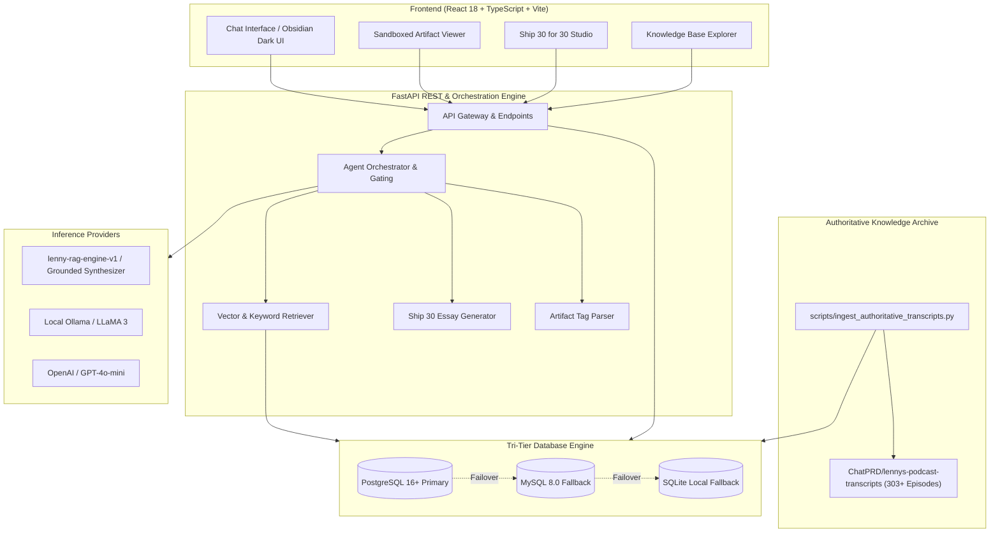
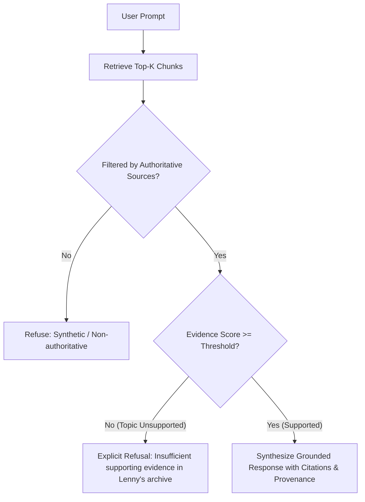

# 🎙️ The Lenny Growth Assistant

<p align="center">
  
  
  
  
  
  
  
  
  
</p>

> **An authoritative, enterprise-grade AI growth advisory intelligence strictly grounded in Lenny Rachitsky’s podcast archive ([ChatPRD/lennys-podcast-transcripts](https://github.com/ChatPRD/lennys-podcast-transcripts)). Features a dedicated Ship 30 for 30 Essay Studio, real-time split-pane sandboxed Artifact Viewer, and a resilient tri-tier database engine (PostgreSQL primary with automated MySQL and SQLite fallbacks).**

---

## 📑 Table of Contents

- [Overview & Architecture](#-overview--architecture)
- [Key Features](#-key-features)
- [System Architecture Diagram](#-system-architecture-diagram)
- [Technology Stack](#-technology-stack)
- [Repository Structure](#-repository-structure)
- [Getting Started](#-getting-started)
  - [Prerequisites](#prerequisites)
  - [1. Clone Repository](#1-clone-repository)
  - [2. Environment Configuration](#2-environment-configuration)
  - [3. Backend Setup](#3-backend-setup)
  - [4. Database Migration](#4-database-migration)
  - [5. Authoritative Knowledge Ingestion](#5-authoritative-knowledge-ingestion)
  - [6. Frontend Setup](#6-frontend-setup)
- [Running the Application](#-running-the-application)
- [Authoritative Source Grounding & Boundary Policy](#-authoritative-source-grounding--boundary-policy)
- [Ship 30 for 30 Studio](#-ship-30-for-30-studio)
- [Split-Pane Sandboxed Artifact Viewer](#-split-pane-sandboxed-artifact-viewer)
- [API Reference](#-api-reference)
- [Automated Testing Suite](#-automated-testing-suite)
- [Database Migration Utility](#-database-migration-utility)
- [License & Acknowledgments](#-license--acknowledgments)

---

## 🌟 Overview & Architecture

**The Lenny Growth Assistant** is designed for product managers, growth practitioners, founders, and executive operators. Unlike general-purpose conversational LLMs that fabricate or hallucinate growth frameworks, this assistant operates under a **strict empirical provenance contract**:

1. **Strictly Grounded Retrieval**: Every recommendation is synthesized strictly from authoritative episode transcripts in the [ChatPRD/lennys-podcast-transcripts](https://github.com/ChatPRD/lennys-podcast-transcripts) repository.
2. **Explicit Boundary Refusals**: When an inquiry is outside the indexed Lenny Rachitsky repository or lacks verified source evidence, the assistant delivers a clear, polite boundary statement rather than guessing.
3. **Tri-Tier Resilient Storage**: Production-ready PostgreSQL database with automatic runtime fallback to local MySQL or SQLite to guarantee 100% service uptime during maintenance.
4. **Sandboxed Artifact Rendering**: Interactive split-pane studio that parses and previews formatted Markdown documents and live HTML/CSS/JS components inside a secure sandboxed iframe (`sandbox="allow-scripts"`).

---

## ⚡ Key Features

- **🎯 Strict Source-Only RAG Engine**: Computes high-density semantic vector embeddings over transcript chunks with mathematical cosine similarity filtering and minimum evidence gating.
- **🛡️ Built-in Provenance Tracking**: Every response links directly to its source episode slug, guest name, timestamped YouTube URL, and repository Markdown file.
- **✍️ Dedicated Ship 30 for 30 Studio**: Produces structured ~1,250-word long-form essays formatted in the Ship 30 framework (*Hook $\rightarrow$ Big Idea $\rightarrow$ Narrative $\rightarrow$ Empirical Evidence $\rightarrow$ Tactical Playbook $\rightarrow$ Key Takeaway*).
- **🖥️ Split-Pane Sandboxed Artifact Viewer**:
  - Live side-by-side rendering of Markdown guides, tactical matrices, and functional HTML apps.
  - Safe sandboxed runtime isolating scripts and styles.
  - One-click source code inspection, clipboard copy, and `.md` / `.html` artifact download.
- **🎨 Obsidian & Charcoal Dark UI**: Designed with ChatGPT-inspired ergonomics, responsive sidebar session management, thinking mode toggles, and dedicated standalone views for Knowledge Base and Settings.
- **🔄 Zero-Downtime Multi-Engine Database Handler**: Automatically identifies whether PostgreSQL, MySQL, or local SQLite is available and routes database sessions accordingly.

---

## 📐 System Architecture Diagram



---

## 🛠️ Technology Stack

| Layer | Technologies |
|---|---|
| **Frontend** | React 18, TypeScript, Vite, Vanilla CSS (zero Tailwind dependency), Lucide Icons |
| **Backend** | Python 3.13 / 3.11+, FastAPI, Pydantic v2, Uvicorn, Python-Dotenv |
| **Data & ORM** | SQLAlchemy 2.0, Alembic Migrations, Psycopg 3 (`psycopg`), PyMySQL, SQLite |
| **Vector & RAG** | Scikit-learn Cosine Similarity, Custom Text Chunker, Semantic Embedder |
| **Inference** | Built-in Grounded Synthesizer (`demo`), Ollama (`llama3:latest`), OpenAI (`gpt-4o-mini`) |
| **Testing** | Pytest 9.1+, AnyIO, Pytest-Asyncio |

---

## 📂 Repository Structure

```text
The-Lenny-Growth-Assistant/
├── backend/
│   ├── alembic/                      # Database migration versions
│   │   ├── versions/
│   │   │   ├── 01_initial_schema.py
│   │   │   └── c1f930e49d82_add_authoritative_metadata.py
│   │   └── env.py
│   ├── app/
│   │   ├── api/
│   │   │   └── endpoints/            # FastAPI route handlers
│   │   │       ├── artifacts.py
│   │   │       ├── chat.py
│   │   │       ├── health.py
│   │   │       ├── knowledge.py
│   │   │       ├── messages.py
│   │   │       └── sessions.py
│   │   ├── core/
│   │   │   ├── config.py             # Pydantic environment settings
│   │   │   └── database.py           # Tri-tier database engine resolver
│   │   ├── models/                   # SQLAlchemy declarative models
│   │   │   ├── artifact.py
│   │   │   ├── knowledge.py
│   │   │   ├── message.py
│   │   │   └── session.py
│   │   ├── schemas/                  # Pydantic request/response schemas
│   │   └── services/
│   │       ├── agent/                # Prompt orchestration & gating
│   │       ├── providers/            # Demo, Ollama, and OpenAI adapters
│   │       └── rag/                  # Chunker, Embedder, Ingester, Retriever
│   ├── tests/                        # 21 Automated Pytest suites
│   ├── alembic.ini                   # Alembic configuration
│   └── requirements.txt              # Backend Python dependencies
├── docs/                             # Architecture & testing specifications
│   ├── agent-transcripts.md
│   ├── architecture.md
│   └── testing.md
├── frontend/
│   ├── src/
│   │   ├── components/               # React UI components
│   │   │   ├── ArtifactViewer.tsx    # Split-pane sandboxed HTML/MD viewer
│   │   │   ├── ChatArea.tsx          # Dynamic message thread
│   │   │   ├── ChatMessage.tsx       # Formatted messages & citations
│   │   │   ├── Header.tsx            # Header & mode toggles
│   │   │   ├── KnowledgePage.tsx     # Standalone knowledge viewer
│   │   │   ├── SettingsPage.tsx      # Standalone settings panel
│   │   │   ├── Ship30StudioPage.tsx  # Fullscreen Ship 30 essay studio
│   │   │   └── Sidebar.tsx           # Session management sidebar
│   │   ├── types/                    # TypeScript interfaces
│   │   ├── App.tsx                   # Main React entry & tab router
│   │   └── index.css                 # Dark theme custom stylesheet
│   ├── package.json
│   ├── tsconfig.json
│   └── vite.config.ts
├── sample_data/                      # Baseline seed data
├── scripts/
│   ├── ingest_authoritative_transcripts.py # Auto-clones and indexes transcripts
│   ├── ingest_sample_data.py               # Indexes sample markdown documents
│   ├── migrate_mysql_to_postgres.py        # Safe database migration utility
│   ├── test_chat_live.py
│   └── test_qa_call.py
├── .env.example                      # Template configuration file
├── .gitignore
├── README.md                         # Project documentation
├── requirements.txt                  # Root Python requirements
├── run_app.bat                       # Windows Batch application launcher
└── run_app.ps1                       # Windows PowerShell launcher
```

---

## 🚀 Getting Started

### Prerequisites

- **Python**: Version 3.10, 3.11, 3.12, or 3.13 installed.
- **Node.js**: Version 18.x or 20.x with `npm`.
- **Git**: Installed and available in PATH.
- **Database (Optional but Recommended)**:
  - **PostgreSQL** 14+ (Recommended primary on port `5432`).
  - Or **MySQL** 8.0+ / XAMPP (Port `3306`).
  - *If neither is installed, the system seamlessly defaults to SQLite (`lenny_growth_assistant_fallback.db`).*

---

### 1. Clone Repository

```bash
git clone https://github.com/SURENRASIVAKUMAR/The-Lenny-Growth-Assistant.git
cd The-Lenny-Growth-Assistant
```

---

### 2. Environment Configuration

Copy the example configuration to `.env`:

```bash
# On Windows PowerShell
Copy-Item .env.example .env

# On Linux / macOS
cp .env.example .env
```

Customize `.env` with your preferred database credentials and AI provider:

```env
# Database Settings (PostgreSQL Primary)
DB_DRIVER=postgresql+psycopg
DB_USER=postgres
DB_PASSWORD=postgres
DB_HOST=localhost
DB_PORT=5432
DB_NAME=lenny_growth_assistant

# AI Provider ("demo" for zero-config built-in synthesizer | "ollama" | "openai")
AI_PROVIDER=demo
```

---

### 3. Backend Setup

Create and activate a Python virtual environment:

```bash
# Create virtual environment
python -m venv venv

# Activate on Windows PowerShell
.\venv\Scripts\Activate.ps1

# Activate on Linux / macOS
source venv/bin/activate

# Install dependencies
pip install -r backend/requirements.txt
```

---

### 4. Database Migration

Run Alembic migrations to construct the database schema:

```bash
alembic -c backend/alembic.ini upgrade head
```

---

### 5. Authoritative Knowledge Ingestion

Populate the database with authentic transcripts from [ChatPRD/lennys-podcast-transcripts](https://github.com/ChatPRD/lennys-podcast-transcripts). The ingestion script automatically clones the archive if not already downloaded:

```bash
# Ingest 12 featured high-signal episodes (300 chunks)
python scripts/ingest_authoritative_transcripts.py --limit 12

# (Optional) Ingest all 300+ podcast episodes
python scripts/ingest_authoritative_transcripts.py --all
```

#### Ingested Episodes Include:
| Guest | Episode Topic | Provenance File |
|---|---|---|
| **Elena Verna** | 10 Growth Tactics That Never Work | `episodes/elena-verna/transcript.md` |
| **Casey Winters** | Scaling Growth Loops, Retention & PMF | `episodes/casey-winters/transcript.md` |
| **Brian Chesky** | Founder-Led Product Management | `episodes/brian-chesky/transcript.md` |
| **Brian Balfour** | The Four Growth Fits | `episodes/brian-balfour/transcript.md` |
| **Patrick Campbell** | SaaS Pricing & Packaging Playbook | `episodes/patrick-campbell/transcript.md` |
| **Shreyas Doshi** | High-Agency Product Management | `episodes/shreyas-doshi/transcript.md` |
| **Sean Ellis** | Growth Hacking & The PMF Survey | `episodes/sean-ellis/transcript.md` |
| **Adam Fishman** | Growth Leadership & Career Paths | `episodes/adam-fishman/transcript.md` |

---

### 6. Frontend Setup

Install the required Node.js packages:

```bash
cd frontend
npm install
cd ..
```

---

## 🏃 Running the Application

### Option A: One-Click Launchers (Windows)

Launch both backend and frontend servers simultaneously:

```powershell
# Using PowerShell
.\run_app.ps1

# Using Batch
.\run_app.bat
```

### Option B: Manual Execution

#### Terminal 1 — Backend:
```bash
# Ensure virtual environment is active
uvicorn backend.app.main:app --host 127.0.0.1 --port 8000 --reload
```
- API Documentation (Swagger): [http://127.0.0.1:8000/docs](http://127.0.0.1:8000/docs)
- Health Endpoint: [http://127.0.0.1:8000/api/health](http://127.0.0.1:8000/api/health)

#### Terminal 2 — Frontend:
```bash
cd frontend
npm run dev
```
- Web Application: [http://localhost:5173](http://localhost:5173)

---

## 🔒 Authoritative Source Grounding & Boundary Policy

The assistant enforces a strict grounding policy designed to eliminate LLM hallucinations:



### Response Policy Rules:

1. **Supported Questions**:
   - Query: *"What does Elena Verna say about growth tactics that never work?"*
   - Outcome: Returns tactical insights with verified citations, guest name, YouTube links, and repository file path (`episodes/elena-verna/transcript.md`).
2. **Unsupported Questions (Lenny domain, but missing evidence)**:
   - Query: *"What did Professor Xavier recommend about telepathy in product design?"*
   - Outcome: Explicit refusal:
     > *"I couldn't find sufficient supporting information for this question in the indexed Lenny’s Podcast / Newsletter repository. I can answer only when the available source material supports the response."*
3. **Unrelated Inquiries**:
   - Query: *"Write a Python script to calculate quantum physics derivatives."*
   - Outcome: Explicit boundary statement:
     > *"I don't have sufficient information about this topic in the specified Lenny’s Podcast / Newsletter repository to provide a source-grounded answer."*

---

## 🖋️ Ship 30 for 30 Studio

The **Ship 30 for 30 Essay Studio** produces atomic essays structured for maximum retention and distribution:

1. **The Hook**: Captures immediate interest with a bold contrarian observation.
2. **The Big Idea**: Articulates the core mental model or strategic shift.
3. **The Narrative**: Grounds the concept in real-world startup scenarios.
4. **Empirical Evidence**: References empirical data, case studies, and quotes from Lenny's guests.
5. **Tactical Playbook**: Provides step-by-step implementation instructions.
6. **Key Takeaway**: One actionable sentence summarizing the core principle.

If the requested topic lacks evidence in the archive, the studio explicitly notes knowledge constraints rather than fabricating quotes or case studies.

---

## 🖼️ Split-Pane Sandboxed Artifact Viewer

When the assistant generates complex growth assets, code snippets, or interactive calculators, it formats them into XML artifact tags:

```xml
<artifact identifier="pmf-scorecard" type="html" title="PMF Survey Calculator">
<!DOCTYPE html>
<html>
  <!-- Self-contained interactive calculator -->
</html>
</artifact>
```

The split-pane viewer provides:
- **Sandboxed Execution**: Runs interactive HTML/JS inside a secure iframe (`sandbox="allow-scripts"`).
- **Markdown Document Preview**: Formats detailed strategies, OKR templates, and retention playbooks.
- **Direct Code View**: Toggle between live visual rendering and raw source code.
- **Export Capabilities**: One-click clipboard copy and file download (`.html` or `.md`).

---

## 📡 API Reference

Interactive OpenAPI documentation is accessible at `http://127.0.0.1:8000/docs`.

### Core Endpoints:

| Method | Endpoint | Description |
|---|---|---|
| `GET` | `/api/health` | Service health, active database engine, and connection status |
| `GET` | `/api/config-status` | Active AI provider, embedding models, and repository path |
| `POST` | `/api/chat` | Send a message to the RAG orchestrator (`standard` or `ship30` mode) |
| `GET` | `/api/sessions` | List all historical chat sessions |
| `POST` | `/api/sessions` | Initialize a new conversation session |
| `DELETE` | `/api/sessions/{session_id}` | Delete a conversation and associated message history |
| `GET` | `/api/knowledge/sources` | List all indexed episodes, chunk counts, and provenance |
| `GET` | `/api/artifacts` | Retrieve all generated artifacts |
| `GET` | `/api/artifacts/{id}` | Fetch a specific artifact by identifier |

---

## 🧪 Automated Testing Suite

The repository includes a comprehensive test suite across unit, integration, and RAG grounding layers.

To run all automated tests:

```bash
pytest backend/tests/ -v
```

### Verified Test Matrix (21 Passing Tests):

- `test_artifacts.py`: Artifact CRUD operations and XML tag parser validation.
- `test_chat_integration.py`: Chat endpoint execution in standard and Ship 30 modes.
- `test_health.py`: Database connection checks and configuration status reporting.
- `test_knowledge_and_retrieval.py`: Source listing, citation formatting, and low-evidence gating.
- `test_providers.py`: OpenAI API key checks, Ollama connectivity, and synthesizer factory.
- `test_sessions_and_isolation.py`: Session isolation, message history preservation, and cascading deletes.
- `test_ship30.py`: Prompt assembly, Ship 30 framework structure, and RAG integration.
- `test_strict_grounding_and_provenance.py`: Authoritative metadata assertions, synthetic source exclusion, verified citations, and boundary refusals.

---

## 🔁 Database Migration Utility

If you have legacy data in a MySQL instance (e.g., from XAMPP on port 3306) and wish to migrate to PostgreSQL:

```bash
python scripts/migrate_mysql_to_postgres.py
```

- **Safe & Non-Destructive**: Reads from MySQL without modifying or dropping any records.
- **Full Integrity**: Migrates sessions, messages, artifacts, and knowledge sources with foreign key relationship preservation.

---

## 📄 License & Acknowledgments

- **Podcast Content & Transcripts**: Grounded in Lenny Rachitsky’s podcast interviews, curated in [ChatPRD/lennys-podcast-transcripts](https://github.com/ChatPRD/lennys-podcast-transcripts).
- **Software License**: Distributed under the [MIT License](LICENSE).
- **Author**: Built with ❤️ for the global product and growth community.
